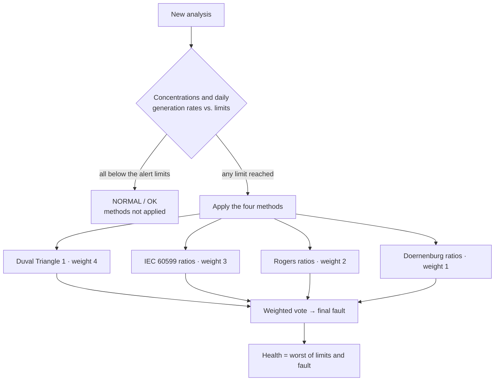

# Tensio

Tensio diagnoses the condition of power transformers in electrical substations from **dissolved gas
analysis (DGA)** of their insulating oil.

When a transformer has an internal fault (partial discharges, overheating, arcing), the oil and the
paper insulation break down and release characteristic gases. Laboratories measure these gases by
chromatography. Tensio stores those measurements, interprets them with the standard DGA methods and shows
which transformers need attention.

It is a monolithic Spring MVC application rendered on the server, with HTMX for partial page updates.

## Features

- **Dashboard**: health summary of the fleet (OK / ALERT / DANGER), the transformers that need attention,
  substations and the latest analyses.
- **Transformers and substations**: lists with search, filters and pagination, detail pages, and create /
  edit forms for administrators.
- **Diagnosis of every analysis**: each analysis is stored together with its diagnosis, computed by four
  interpretation methods combined into a final fault and a health status (see
  [How the diagnosis works](#how-the-diagnosis-works)).
- **Analysis input**: a form for one analysis, or a **CSV import** processed in the background with
  Spring Batch, in which invalid lines are skipped and reported.
- **E-mail summary**: after analyses are diagnosed, the user who submitted them receives a summary with
  the results and the rejected CSV lines.
- **Gas charts**: concentration of each gas against its limits, split into combustible and
  non-combustible gases (Chart.js).
- **PDF data sheet** of a transformer with its latest diagnosis and charts (JasperReports).
- **Maps**: substations on an OpenStreetMap map (Leaflet), on the list and on the detail page.
- **Users**: sign-in with users stored in the database. Administrators can change the role and the status
  of users.
- **Dark mode**, friendly error pages (404 / 5xx) and optional HTTPS.

## How the diagnosis works



1. **Limits.** Every gas is compared with its alert and danger concentrations. When there is a previous
   analysis of the same transformer, the daily generation rate (ppm/day) is compared with its alert and
   danger rates too. The limits are configured in `application.yaml` (`tensio.dga.limits`).
2. **Normal oil.** When every value is below its alert limit, the result is `NORMAL` / `OK` and the
   interpretation methods are not applied, as IEC 60599 recommends.
3. **Interpretation methods.** Otherwise, four methods are applied. Each one may be *not applicable* to a
   given analysis.

   | Method | Based on | Weight |
   |---|---|---|
   | Duval Triangle 1 | relative % of CH₄, C₂H₄, C₂H₂ (IEEE C57.104-2019 zones) | 4 |
   | IEC 60599 | ratios C₂H₂/C₂H₄, CH₄/H₂, C₂H₄/C₂H₆ | 3 |
   | Rogers | ratios C₂H₂/C₂H₄, CH₄/H₂, C₂H₄/C₂H₆ | 2 |
   | Doernenburg | four ratios, only above the L1 limits | 1 |

4. **Final fault.** It is the fault with the highest sum of weights; a tie goes to the most severe fault.
   When no method applies, a documented fallback decides between `PD` and `THERMAL`. The final fault is
   never empty: an analysis can never be "inconclusive".
5. **Health status.** It is the worse of the status given by the limits and the status implied by the
   fault (`T3` and `D2` are `DANGER`; other faults are `ALERT`).

| Fault | Meaning |
|---|---|
| `NORMAL` | No fault |
| `PD` | Partial discharge |
| `T1` | Thermal fault < 300 °C |
| `T2` | Thermal fault 300–700 °C |
| `THERMAL` | Thermal fault, unspecified temperature |
| `D1` | Low-energy discharge |
| `DT` | Mixed thermal and electrical fault |
| `T3` | Thermal fault > 700 °C |
| `D2` | High-energy discharge (arcing) |

Analyses inserted by SQL scripts without a diagnosis are diagnosed when the application starts.

## Tech stack

| Area | Technology |
|---|---|
| Language / build | Java 25, Maven (wrapper `./mvnw`) |
| Framework | Spring Boot 4.1 (Spring Framework 7): MVC, Security, Data JPA, Batch, Mail, Validation, Actuator |
| Views | Freemarker (`.ftlh`), HTMX, Bootstrap 5, Bootstrap Icons, Chart.js, Leaflet (WebJars) |
| Database | PostgreSQL, Flyway migrations |
| Mapping | MapStruct, Lombok |
| Reports | JasperReports 7 |
| Tests | JUnit 5, Mockito, AssertJ, Testcontainers, Playwright |
| Quality | JaCoCo (80 % minimum line coverage), Checkstyle, Maven Enforcer |
| Runtime | Docker (Alpine image), Docker Compose (PostgreSQL, Mailpit) |

## Getting started

### Requirements

- JDK 25
- Docker (for PostgreSQL and Mailpit in development, and for the integration tests)

### Run in development

```bash
./mvnw spring-boot:run -Dspring-boot.run.profiles=dev
```

The Spring Boot Docker Compose support starts the services of `compose.yaml` automatically:

- **PostgreSQL**: database. The `dev` profile also loads sample data: 20 substations, 150 transformers and
  3 years of monthly analyses.
- **Mailpit**: catches the e-mails sent by the application. Web UI on <http://localhost:8025>.

Open <http://localhost:8080> and sign in with a sample user:

| E-mail | Password | Role |
|---|---|---|
| `admin@tensio.local` | `admin` | ADMIN |

The other sample users are listed in `src/main/resources/db/dev/V7__dummy_users.sql`.

### Run with Docker

```bash
docker compose --profile app up --build
```

This builds the application image (`Dockerfile`, multi-stage, Alpine, non-root user) and starts it with
PostgreSQL and Mailpit, using the `dev` profile.

### HTTPS

The `tls` profile makes the application serve HTTPS on port 8443. Combine it with another profile and
provide PEM files through environment variables; certificates are never committed.

```bash
export TLS_CERTIFICATE=file:/etc/tensio/tls/fullchain.pem
export TLS_PRIVATE_KEY=file:/etc/tensio/tls/privkey.pem
SPRING_PROFILES_ACTIVE=dev,tls ./mvnw spring-boot:run
```

## Configuration

| Property / variable | Default | Description |
|---|---|---|
| `SERVER_PORT` | `8080` (`8443` with `tls`) | HTTP(S) port |
| `TENSIO_BASE_URL` | `http://localhost:8080` | Base of the links in the e-mails |
| `TENSIO_MAIL_FROM` | `tensio@localhost` | Sender of the e-mails |
| `spring.mail.host` / `port` | Mailpit in `dev` | SMTP server; without one, e-mails are only logged |
| `tensio.dga.limits.<gas>` | see `application.yaml` | Alert and danger concentrations (ppm) and rates (ppm/day) |

Profiles:

- `dev`: local database, sample data, SMTP to Mailpit.
- `test`: used by the test suite (Testcontainers), with a small fixture.
- `tls`: HTTPS served by the application.

## CSV import

Go to *Analyses → Import CSV*. A template can be downloaded from that page.

```csv
transformer_tag,sample_date,h2,ch4,c2h2,c2h4,c2h6,co,co2,o2,n2
TR-101,2026-10-01,15.2,8.1,0,4.3,7.9,210,1850,3100,45200
```

- Required columns: `transformer_tag`, `sample_date`, `h2`, `ch4`, `c2h2`, `c2h4`, `c2h6`, `co`, `co2`.
  Optional columns: `o2`, `n2`. Columns may be in any order. Gas values are in ppm.
- The separator is `,` or `;`. With `;`, a decimal comma is accepted.
- Dates are `yyyy-MM-dd` or `dd/MM/yyyy`.
- Lines for unknown or decommissioned transformers, and dates that already have an analysis, are rejected.
  Rejected lines are listed in the summary e-mail.

## Architecture

Base package `com.ppossatto.tensio`:

| Package | Responsibility |
|---|---|
| `controller` | `@Controller` classes: fill the model, return a view |
| `service` | Use cases (diagnosis storage, CSV import in `service/batch`, e-mail, reports) |
| `domain` | Business rules and types: limits, diagnosis engine and methods (`domain/diagnosis`) |
| `entity` / `repository` | JPA entities and Spring Data repositories; read-only projections in `repository/projection` |
| `form` | Input DTOs of the forms, validated with Bean Validation |
| `mapper` | MapStruct mappers between entities, domain types and forms |
| `config` | Security, JPA, async and view configuration |

Entities never reach controllers or templates: they are converted to domain objects by MapStruct.
Schema changes are Flyway migrations in `db/migration`; sample data lives in `db/dev` and runs only with
the `dev` profile. Contribution rules for the codebase are in [CLAUDE.md](CLAUDE.md).

## Tests and quality

```bash
./mvnw verify
```

`verify` runs, in order:

1. Enforcer (Java 25+, Maven 3.9+) and Checkstyle (warnings only).
2. Unit tests (Surefire): the diagnosis methods, the engine, the services and the CSV parsing.
3. Integration tests (Failsafe) against PostgreSQL in Testcontainers: pages, forms, the stored diagnosis
   of analyses and the CSV import.
4. End-to-end tests with Playwright (`*BrowserIT`).
5. The JaCoCo report (`target/site/jacoco/index.html`). The build fails below 80 % line coverage.

Docker must be running for the integration and end-to-end tests.

## License

[MIT](LICENSE)
